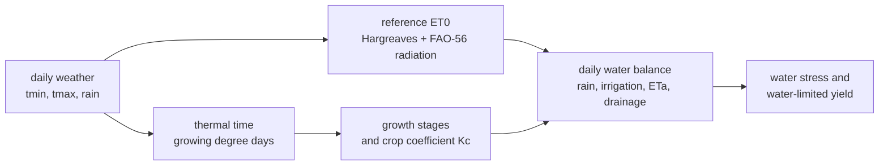

# sawah

[](https://github.com/augustusdexterous/sawah/actions/workflows/ci.yml)


**Sawah** (Malay and Indonesian for a wet rice field) turns a season of daily weather into a rice plan: when the crop reaches each growth stage, how much water it uses, when it runs short, and what yield the water allows.

It takes one CSV of daily temperature and rain, plus a planting date and a latitude, and returns a season report in seconds. There are no runtime dependencies. Everything is plain Python with a test suite and a documented method.

> Sawah gives planning estimates from simplified, literature-based models. The defaults are not calibrated to any cultivar or field. Calibrate them with local records before you rely on the dates or the yield. See [Limits](#limits).

```console
$ sawah examples/sample_weather.csv --lat 14.5 --planting 2026-06-15 --cultivar medium --potential-yield 8
planting           : 2026-06-15  cultivar: medium (2000 GDD to maturity)
stages:
  vegetative      2026-06-15 to 2026-08-21
  flowering       2026-08-22 to 2026-08-30
  grain filling   2026-08-31 to 2026-10-04
maturity           : 2026-10-04
rain               :    472.2 mm
ET0 (reference)    :    527.8 mm
ETc (potential)    :    552.6 mm
ETa (actual)       :    497.9 mm
irrigation applied :      0.0 mm
drainage           :     12.1 mm
water stress days  : 43
hot flowering days : 0 (tmax >= 35 C during flowering)
water factor       : 0.891
water-limited yield: 7.13 t/ha (potential 8.00 t/ha)
```

The sample weather is **synthetic** (generated by `examples/make_sample_weather.py`) and ships with the repository, not the pip package, so the numbers show the output format, not a real harvest.

## What irrigation changes

Same planting date, same latitude, same cultivar. "Half rain" is the sample file with every rain value halved, written at full precision. The second column turns irrigation on or off.

| Weather | Irrigation | Water-limited yield | Water stress days | Irrigation applied |
|---|---|---|---|---|
| normal rain | no | 7.13 t/ha | 43 | 0 mm |
| normal rain | `--irrigate` | 8.00 t/ha | 0 | 102 mm |
| half rain | no | 4.18 t/ha | 93 | 0 mm |
| half rain | `--irrigate` | 8.00 t/ha | 0 | 263 mm |

The "irrigation applied" column is the water requirement the model assumes. It does not model pumping, cost or supply limits.

## Install

```bash
pip install git+https://github.com/augustusdexterous/sawah.git
```

Python 3.9 or newer. No third-party runtime dependencies.

## Quick start

Your weather file needs four columns, one row per day, with no gaps:

```csv
date,tmin,tmax,rain
2026-06-01,23.2,30.2,1.7
2026-06-02,22.8,30.7,5.3
```

Then run:

```console
$ sawah weather.csv --lat 14.5 --planting 2026-06-15
$ sawah weather.csv --lat 14.5 --planting 2026-06-15 --irrigate --cultivar late --potential-yield 9
$ sawah weather.csv --lat 14.5 --planting 2026-06-15 --json           # machine-readable summary
$ sawah weather.csv --lat 14.5 --planting 2026-06-15 --daily day.csv  # every simulated day
```

From Python:

```python
from datetime import date
from sawah import load_weather, run_season

days = load_weather("weather.csv")
result = run_season(days, lat_deg=14.5, planting=date(2026, 6, 15), cultivar="medium", potential_yield=8.0)
if result.matured:
    print(result.maturity_date, result.water_limited_yield)
print(result.to_dict())
```

## How it works



1. **Thermal time.** Growing degree days above 10 °C, using the daily mean temperature capped at 35 °C. The cultivar sets the total: early 1500, medium 2000, late 2400 GDD.
2. **Growth stages.** Vegetative to 60% of the thermal time, flowering to 68%, grain filling to maturity.
3. **Reference evapotranspiration.** Hargreaves–Samani (1985), with extraterrestrial radiation from the FAO-56 equations. It needs only temperature and latitude.
4. **Water balance.** One root-zone store, 100 mm at capacity. Rain is added, the crop takes Kc × ET0 scaled by a stress factor, and water above capacity drains.
5. **Yield.** The FAO-33 water-yield response, `potential × (1 − Ky × (1 − ETa/ETc))`, with Ky = 1.1.

The full equations, every assumption and the references are in [docs/method.md](docs/method.md).

## Options

| Option | Default | Meaning |
|---|---|---|
| `--lat` | required | latitude in degrees, north positive, between −60 and 60 |
| `--planting` | required | planting date, `YYYY-MM-DD`, inside the weather record |
| `--cultivar` | `medium` | `early`, `medium` or `late` |
| `--potential-yield` | `8.0` | potential yield in t/ha |
| `--irrigate` | off | refill the root zone when it drops below the stress threshold or the day's crop demand |
| `--water-capacity` | `100` | root-zone storage at capacity, mm |
| `--stress-fraction` | `0.5` | storage fraction below which crop stress starts (FAO-56: 1 − p) |
| `--daily PATH` | none | write the day-by-day simulation to a CSV |
| `--json` | off | print the season summary as JSON |

## Input rules

- Columns: `date` (ISO, `YYYY-MM-DD`), `tmin`, `tmax`, `rain` (mm). Headers are case-insensitive.
- Rows may be in any order and are sorted by date. Duplicate dates are rejected.
- `tmax` must be greater than `tmin`. Rain cannot be negative or above 2000 mm in a day. No value may be missing.
- UTF-8 with or without a byte-order mark. Semicolon-separated files are rejected with a message that says so.

## Output you can trust

- **No silent yield.** A season that does not reach maturity inside the weather record reports no yield. It says so.
- **Water balances.** Every day, inflow equals outflow plus the change in storage. The test suite checks this on fixed seasons and on 300 seeded random seasons.
- **Stress needs a shortfall.** Stress is judged on the water available after the day's rain and irrigation. A day is a water-stress day when ETa falls below ETc. A day is not stressed only if that water covers both the threshold and the day's ETc.
- **Clear errors.** The Python API rejects NaN or negative rain, zero temperature range, and out-of-order or gapped days, instead of using them.

## Limits

- Not calibrated to any cultivar, soil or field. Thermal times, stage fractions, Kc, Ky, water capacity and the stress threshold are defaults to replace with local data.
- One root-zone store. No soil layers, flood depth, weeds, pests, nutrients, salinity or temperature effects on sterility beyond a count of hot flowering days.
- Irrigation water is assumed available. Irrigated days meet the full crop demand; the model reports the requirement, not a supply plan.
- Latitude is limited to ±60°, the range this model is meant for.
- The model has not been validated against field trials. That is the next step before any real decision.

## Development

```bash
git clone https://github.com/augustusdexterous/sawah.git
cd sawah
pip install -e ".[dev]"
python -m pytest -q
ruff check . && ruff format --check .
```

Tests cover the water balance (fixed and seeded random seasons), the yield formula, maturity and stage boundaries, the thermal and radiation equations, input validation, the file loader and the command line. Continuous integration runs them on Python 3.9 to 3.13.

## References

- Allen, R. G., Pereira, L. S., Raes, D., & Smith, M. (1998). *Crop evapotranspiration: guidelines for computing crop water requirements*. FAO Irrigation and Drainage Paper 56.
- Doorenbos, J., & Kassam, A. H. (1979). *Yield response to water*. FAO Irrigation and Drainage Paper 33.
- Hargreaves, G. H., & Samani, Z. A. (1985). Reference crop evapotranspiration from temperature. *Applied Engineering in Agriculture*, 1(2), 96–99.

## Citation

See [CITATION.cff](CITATION.cff). Please also cite the references above for the methods.

## License

MIT. See [LICENSE](LICENSE).
